# ERD Gold v1

Các mối quan hệ dưới đây là logical dimension links, không phải foreign-key enforcement của Iceberg. Grain/cột xem [data dictionary](data-dictionary-v1.md). Mỗi đường tới dim_date có thể gồm nhiều role-playing date keys.

```mermaid
erDiagram
    dim_date ||--o{ fact_order : order_date
    dim_customer ||--o{ fact_order : customer
    dim_channel ||--o{ fact_order : channel
    dim_voucher ||--o{ fact_order : voucher
    dim_date ||--o{ fact_sales_line : order_and_scheduled_settlement_date
    dim_product ||--o{ fact_sales_line : product
    dim_customer ||--o{ fact_sales_line : customer_or_unknown
    dim_channel ||--o{ fact_sales_line : channel
    dim_voucher ||--o{ fact_sales_line : voucher_or_unknown
    dim_date ||--o{ fact_shipment : order_shipped_delivered_eta_date
    dim_carrier ||--o{ fact_shipment : carrier
    dim_geography ||--o{ fact_shipment : recipient_region
    dim_date ||--o{ fact_return : order_and_request_date
    dim_customer ||--o{ fact_return : customer
    dim_channel ||--o{ fact_return : direct_channel
    dim_product ||--o{ fact_inventory_transaction : product
    dim_date ||--o{ fact_inventory_transaction : business_date_unknown_if_unreliable
    dim_date ||--o{ fact_inventory_daily_snapshot : observed_eod_only
    dim_product ||--o{ fact_inventory_daily_snapshot : product
    dim_warehouse ||--o{ fact_inventory_daily_snapshot : observed_warehouse
    dim_date ||--o{ fact_product_review : review_date
    dim_product ||--o{ fact_product_review : product
    dim_customer ||--o{ fact_product_review : customer
    dim_channel ||--o{ fact_product_review : direct_channel
```

Không nối fact-to-fact trong semantic model. Source order IDs vẫn dùng trong controlled transformations để lookup/reconcile. fact_return không có product_key; fact_shipment không gán warehouse thiếu nguồn. Inventory historical backfill chưa đạt gate vì timestamp nguồn.
