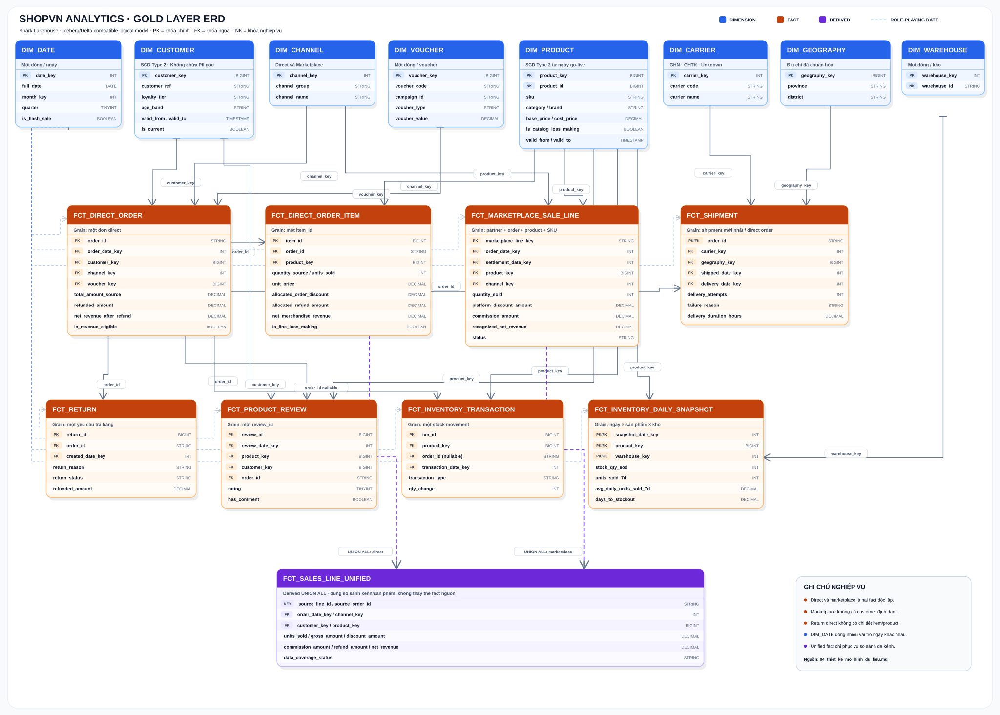
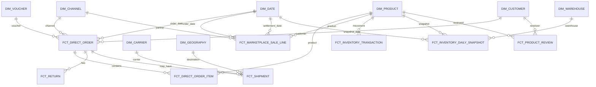

# ShopVN Analytics - Data Model Design

**Recommended stack:** Spark Lakehouse with PySpark + Delta Lake + MinIO  
**Modeling approach:** Medallion Architecture for processing, dimensional star schema for analytics  
**Scope:** Finance, Operations, Marketing/Customer, Inventory/Product

---

## 1. Executive decision

Use three logical layers:

1. **Bronze** keeps immutable, source-shaped data plus ingestion metadata.
2. **Silver** validates, standardizes, masks PII, deduplicates, and preserves each source's original grain.
3. **Gold** exposes conformed dimensions, business-process facts, and a small set of aggregate marts.

Direct orders and marketplace sales must remain in **separate facts** because they have different identifiers, grains, customer coverage, fees, discount rules, return semantics, and settlement behavior. They are combined only through a derived `fct_sales_line_unified` view after both sides have been normalized to line grain.

Use a Spark Lakehouse because the project is intended not only for the sample dataset but also for simulated continuously growing sources and scale testing. PySpark provides distributed processing; Delta Lake adds ACID transactions, schema enforcement/evolution, `MERGE`, time travel, and unified batch/streaming support; MinIO provides S3-compatible object storage in the local environment. The higher operating cost than DuckDB is an accepted trade-off for a production-like architecture that will not require redesign when data volume grows substantially.

---

## 2. Modeling principles

- Declare the grain before defining each table.
- Never join `orders`, `order_items`, and `returns` directly and then sum order amounts. Aggregate child tables to the parent grain first to avoid fan-out.
- Keep additive money measures and DQ flags in base facts. Calculate ratios and averages in marts or the semantic layer.
- Use surrogate keys in dimensions and preserve source business keys only in secured Silver mappings.
- Use a stable `unknown` dimension row with key `0` for missing/late dimension records.
- Treat event time and processing time separately: every fact has `event_date_key`, `ingested_at`, and `batch_id`.
- Make all loads deterministic with a declared natural key and `MERGE`, or replace an exact date partition inside one transaction.
- Do not silently repair business anomalies. Preserve the source value, add a flag, and exclude only where the stated rule requires exclusion.

---

## 3. Layer design

### 3.1 Bronze - immutable source capture

Store each layer as **Delta tables on MinIO**, for example `s3a://shopvn-lakehouse/bronze/...`. Delta uses Parquet data files and manages transactions through `_delta_log`. Register table metadata in a shared catalog/metastore so Spark SQL, PySpark jobs, and query tools use the same schema definitions.

| Bronze dataset | Source grain | Partition / identity | Notes |
|---|---|---|---|
| `brz_pg_customers` | one source customer row | `extract_date` | Contains restricted PII; Data Engineer role only |
| `brz_pg_products` | one source product row | `extract_date` | Full daily snapshot is acceptable at this scale |
| `brz_pg_orders` | one direct order | `order_date` | Preserve all source amounts and statuses |
| `brz_pg_order_items` | one `item_id` | parent order date | Preserve zero-quantity rows |
| `brz_pg_vouchers` | one voucher | `extract_date` | Snapshot/hash changes |
| `brz_pg_inventory` | one product current balance | `extract_date` | Snapshot source, not historical truth |
| `brz_pg_inventory_transactions` | one `txn_id` | transaction date | Append incrementally |
| `brz_pg_returns` | one `return_id` | created date | Append/upsert because status may change |
| `brz_pg_product_reviews` | one `review_id` | created date | Append/upsert |
| `brz_api_shipments` | one shipment response per direct order | extraction date | Upsert because shipment status evolves |
| `brz_api_not_found` | one requested order and attempt | extraction date | Records deterministic 404 coverage |
| `brz_sftp_marketplace` | one CSV row | partner + business date | Load only after MD5 validation |

All Bronze rows should also carry `_source_system`, `_source_object`, `_ingested_at`, `_batch_id`, and `_record_hash`. SFTP rows additionally carry `_source_file`, `_source_row_number`, `_expected_md5`, and `_actual_md5`.

### 3.2 Silver - clean, source-conformed tables

Silver tables retain source grain and are the reconciliation boundary:

- `slv_customer`: PII removed or tokenized; normalized geography and loyalty tier.
- `slv_product`: standardized category/SKU; `is_catalog_loss_making = cost_price > base_price`.
- `slv_direct_order`: one order; all source values plus revenue eligibility flags.
- `slv_direct_order_item`: one `item_id`; zero quantity retained but `is_units_eligible = false`.
- `slv_return`: one `return_id`; only `status = 'refunded'` contributes to refunded value.
- `slv_shipment`: latest known API state per `order_id`, with timezone-normalized timestamps.
- `slv_marketplace_sale`: validated marketplace row, with source `net_revenue` and recomputed reconciliation value.
- `slv_inventory_transaction`, `slv_review`, and `slv_voucher` at their source grains.

Rows that fail structural checks go to `ops.rejected_record`; valid business anomalies remain in Silver with explicit flags.

### 3.3 Gold - dimensional model

Gold contains conformed dimensions, facts, and aggregate marts described below.

---

## 4. Conformed dimensions

| Dimension | Grain and key | SCD strategy | Important attributes |
|---|---|---|---|
| `dim_date` | one calendar date, `date_key = YYYYMMDD` | static | day/week/month/quarter/year, weekday, month start/end, flash-sale flag |
| `dim_channel` | one sales channel | static | `channel_group` = direct/marketplace; `channel_name` = web/app/lazada/shopee/tiktok |
| `dim_customer` | one version of a customer | **SCD Type 2** | anonymous `customer_ref`, city/district/ward, gender, age band, loyalty tier, `valid_from`, `valid_to`, `is_current`, `history_reliable` |
| `dim_product` | one version of a ShopVN product | SCD Type 2 from pipeline go-live | SKU, name, category, subcategory, brand, base price, cost price, weight, active flag, catalog-loss flag, validity columns |
| `dim_voucher` | one voucher code | Type 1; detect unexpected mutation | type, value, limits, campaign, validity dates |
| `dim_carrier` | one carrier | static | ghn, ghtk, unknown |
| `dim_geography` | one normalized province/district pair | Type 1 | province, district, normalized codes if available |
| `dim_warehouse` | one warehouse | Type 1 | warehouse business key and descriptive fields when available |

### Loyalty history rule

The source contains only the current tier. On the first pipeline run:

- create a pre-observation customer version with `loyalty_tier = 'unknown'`, valid until the go-live timestamp;
- create the observed current version starting at the go-live timestamp;
- on later snapshots, close the current row and insert a new row only when the tracked attribute hash changes.

This prevents the current tier from being falsely assigned to old orders. Reports should expose both:

- **current-tier segmentation**, joining a customer to `is_current = true`; and
- **tier-at-order segmentation**, joining by the order timestamp, with `history_reliable = false` for pre-go-live history.

PII such as full name, phone, email, and full date of birth is not needed in Gold. Use a stable keyed HMAC as `customer_ref`, retain only age band, and keep any reversible mapping in a restricted schema.

---

## 5. Fact tables

### 5.1 `fct_direct_order`

**Grain:** one PostgreSQL direct order (`order_id`).  
**Natural key:** `order_id`.  
**Load:** `MERGE` by `order_id`; update mutable status/payment/refund measures.

Key columns:

- `order_id` as a degenerate dimension
- `order_date_key`, `customer_key`, `channel_key`, optional `voucher_key`
- order status, payment method, payment status
- `subtotal_amount`, `shipping_fee_amount`, `discount_amount`, `total_amount_source`
- `refunded_amount` aggregated from `fct_return` where return status is `refunded`
- `net_revenue_after_refund`
- `is_discount_anomaly`, `is_shipping_fee_anomaly`, `is_revenue_eligible`
- `ingested_at`, `batch_id`

Recommended finance rule:

```text
is_revenue_eligible = discount_amount <= subtotal

net_revenue_after_refund =
  CASE
    WHEN NOT is_revenue_eligible THEN NULL
    WHEN order_status = 'cancelled' THEN 0
    ELSE total_amount_source - refunded_amount
  END
```

Keep `NULL`, not zero, for a discount anomaly so Finance can distinguish rejected revenue from a genuine zero-value order. Whether non-cancelled but unpaid orders are recognized revenue is not specified by the source contract; expose payment status and obtain Finance sign-off before adding a stricter paid-only filter.

### 5.2 `fct_direct_order_item`

**Grain:** one source `item_id`.  
**Natural key:** `item_id`.  
**Load:** `MERGE` by `item_id`.

Key columns:

- `order_id`, `order_date_key`, `customer_key`, `product_key`, `channel_key`, optional `voucher_key`
- `quantity_source`, `units_sold`
- `unit_price`, `discount_per_item`, `line_amount_source`
- `allocated_order_discount`, `allocated_shipping_fee`, `allocated_refund_amount`
- `net_merchandise_revenue`, `reconciled_order_revenue_component`
- `cost_amount_at_ingestion`, `is_line_loss_making`
- `is_zero_quantity`, `is_revenue_eligible`, `is_refund_allocation_estimated`

Rules:

```text
units_sold = CASE WHEN quantity_source > 0 THEN quantity_source ELSE 0 END

effective_unit_sale_price =
  (line_amount_source - allocated_order_discount) / NULLIF(units_sold, 0)

is_line_loss_making = cost_price_at_ingestion > effective_unit_sale_price
```

Allocate order-level discounts, shipping, and refunds only across positive-value items using a deterministic proportional method with a largest-remainder adjustment so allocated VND sums exactly equal the order-level amount. Use `fct_direct_order` for official Finance totals; line allocation is for product attribution because the return source has no returned-item detail.

### 5.3 `fct_marketplace_sale_line`

**Grain:** one marketplace order line: partner + external order + ShopVN product + seller SKU.  
**Natural key:** `(partner, external_order_id, shopvn_product_id, seller_sku)`.  
**Load:** process only checksum-valid files; `MERGE` by natural key and reject conflicting duplicates.

Key columns:

- `external_order_id`, `order_date_key`, `settlement_date_key`, `product_key`, `channel_key`
- `quantity_sold`, `sale_price`, `gross_sale_amount`
- `platform_discount_amount`, `commission_rate`, `commission_amount_recomputed`
- `net_revenue_source`, `net_revenue_recomputed`, `recognized_net_revenue`
- status = completed/returned/disputed
- `is_amount_reconciled`, source-file lineage columns, `batch_id`

Use the source `net_revenue` as the booked value only after reconciling it to the documented formula within a defined VND rounding tolerance. A safe default semantic rule is:

```text
recognized_net_revenue =
  CASE WHEN status = 'completed' THEN net_revenue_source ELSE 0 END
```

Keep returned and disputed amounts separately. `settlement_date` represents the scheduled T+15 settlement date; without a payment-confirmation field it must not be labeled as proven cash received.

### 5.4 `fct_return`

**Grain:** one return request (`return_id`).  
**Natural key:** `return_id`.  
**Load:** `MERGE` because return status can progress from pending to refunded.

Columns include `order_id`, customer/order/channel keys resolved through the direct order, created date, reason, status, `refund_amount_source`, and `refunded_amount = refund_amount_source` only when status is `refunded`.

The source has no `product_id` or return-item table. Therefore an exact item/category return rate is impossible. The defensible proxy is an **order return rate by category**:

```text
distinct refunded orders containing category
------------------------------------------------
distinct eligible orders containing category
```

Do not call this an item return rate. If exact product returns are required, add a source `return_items(return_id, item_id, quantity, refund_amount)` contract.

### 5.5 `fct_shipment`

**Grain:** latest shipment state for one direct `order_id`.  
**Natural key:** `order_id`.  
**Load:** `MERGE`; overwrite current state while Bronze retains response history.

Columns include carrier, shipment status, tracking code, shipped/delivered/estimated date keys, recipient geography, actual shipping fee, attempts, failure reason, and delivery duration in hours.

Orders without an API row do not receive a fake shipment fact. The delivery mart starts from `fct_direct_order` and left joins this fact, then derives `has_shipment = false` and unknown carrier/geography for the expected 404/cancelled-before-pickup population.

### 5.6 `fct_inventory_transaction`

**Grain:** one stock movement (`txn_id`).  
**Natural key:** `txn_id`.  
**Load:** append/`MERGE` by transaction ID.

Columns include product, optional order, transaction timestamp/date, movement type, and signed `qty_change`. It is the audit fact supporting inventory reconstruction.

### 5.7 `fct_inventory_daily_snapshot`

**Grain:** one snapshot date x product x warehouse.  
**Natural key:** `(snapshot_date_key, product_key, warehouse_key)`.  
**Load:** recompute and atomically replace/merge the requested date partition.

Columns include `stock_qty_eod`, `units_sold_7d`, `avg_daily_units_sold_7d`, and `days_to_stockout`. Keep both the raw seven-day rate and an optional flash-sale-adjusted rate; label the latter as a forecast assumption.

Reconstruction:

```text
stock_qty_eod(D) = current_stock_qty
                   - sum(qty_change where transaction_time > end_of_day(D))
```

If the initial current balance and complete transaction history do not reconcile, fail the snapshot quality gate rather than publishing negative or unexplained stock.

### 5.8 `fct_product_review`

**Grain:** one review (`review_id`).  
**Natural key:** `review_id`.  
**Load:** `MERGE` by review ID.

Columns include review date, product, customer, direct order, inferred direct channel, rating, `has_comment`, and optional redacted comment reference. Free-text comments should not be copied to unrestricted Gold without a PII scan.

The supplied review source covers direct PostgreSQL orders only. It cannot support marketplace rating comparison unless marketplace review data is added.

---

## 6. Unified sales view

Create `gold.fct_sales_line_unified` as a **view or incrementally built table**, not as the only sales fact.

**Grain:** one normalized direct or marketplace order line.

Common columns:

| Column | Direct mapping | Marketplace mapping |
|---|---|---|
| `source_order_id` | `order_id` | `external_order_id` |
| `source_line_id` | `item_id` | composite marketplace natural key |
| `order_date_key` | direct order date | marketplace order date |
| `settlement_date_key` | null | T+15 scheduled date |
| `channel_key` | web/app | lazada/shopee/tiktok |
| `customer_key` | known customer | unknown key `0` |
| `product_key` | ShopVN product | joined by `shopvn_product_id` |
| `units_sold` | positive quantity only | `quantity_sold` |
| `gross_amount` | line amount before allocated order discount | sale price x quantity |
| `discount_amount` | item discount + allocated order discount | platform discount |
| `commission_amount` | 0 | platform commission |
| `refund_amount` | estimated allocated refund | returned line amount according to approved semantic rule |
| `net_revenue` | allocated net line revenue | recognized marketplace net revenue |
| `data_coverage_status` | complete/invalid | complete/missing/corrupt/late |

Use this view for channel/product comparisons. Use the source-specific facts for detailed Finance reconciliation.

Never join `external_order_id` to a direct `order_id`. The only cross-source marketplace relationship is through ShopVN product ID and shared dimensions such as date/channel.

---

## 7. Aggregate marts

These are optional materialized tables. Their SQL should be reproducible from Gold facts.

| Mart | Grain | Main use cases |
|---|---|---|
| `mart_daily_revenue` | date x channel | gross, discounts, commission, refunds, net revenue, valid/excluded row counts, coverage status |
| `mart_customer_spend_daily` | date x direct customer | daily spend and order count |
| `mart_customer_spend_monthly` | month x direct customer | monthly spend, rank, first/repeat indicators |
| `mart_campaign_daily` | date x voucher/campaign | usage, attributed revenue, discount cost, average order value |
| `mart_delivery_daily_carrier` | delivery/order date x carrier | success/failure rate, average delivery hours, redelivery rate |
| `mart_delivery_failure_reason` | date x carrier x geography x reason | failed shipment distribution |
| `mart_product_channel_daily` | date x product x channel | units, gross/net revenue, returned units/order proxy, loss flag |
| `mart_inventory_health_daily` | snapshot date x product | stock, 7-day velocity, days to stockout, stockout-within-7-days flag |
| `mart_customer_lifecycle` | direct customer | first order, latest order, order count, days inactive, repeat-within-30-days flag |

Do not compute top customers across all channels: the SFTP source contains no customer identifier. Customer-level metrics are direct-channel metrics and should be labeled accordingly.

---

## 8. ERD - Gold layer



> PNG version: [`images/shopvn_gold_erd.png`](images/shopvn_gold_erd.png). Prefer the SVG in documents and slides because it remains sharp at any zoom level.



`fct_sales_line_unified` and the marts are omitted from the ERD because they are derived from the base facts.

---

## 9. Source-to-target matrix

| Source | Primary Silver target | Primary Gold target |
|---|---|---|
| PostgreSQL `customers` | `slv_customer` | `dim_customer` |
| PostgreSQL `products` | `slv_product` | `dim_product` |
| PostgreSQL `orders` | `slv_direct_order` | `fct_direct_order` |
| PostgreSQL `order_items` | `slv_direct_order_item` | `fct_direct_order_item` |
| PostgreSQL `vouchers` | `slv_voucher` | `dim_voucher` |
| PostgreSQL `inventory` | current balance staging | `fct_inventory_daily_snapshot` |
| PostgreSQL `inventory_transactions` | `slv_inventory_transaction` | `fct_inventory_transaction`, snapshot reconstruction |
| PostgreSQL `returns` | `slv_return` | `fct_return`, direct-order refund aggregate |
| PostgreSQL `product_reviews` | `slv_review` | `fct_product_review` |
| Logistics API | `slv_shipment` | `fct_shipment` |
| Marketplace SFTP | `slv_marketplace_sale` | `fct_marketplace_sale_line` |

---

## 10. Idempotency and physical load strategy

| Table class | Strategy | Idempotency key |
|---|---|---|
| Immutable event facts | `MERGE ... WHEN NOT MATCHED INSERT`; compare hash on match | source event ID |
| Mutable facts | `MERGE` update only when source hash changes | source business key |
| Type 1 dimensions | `MERGE` | natural key |
| Type 2 dimensions | close current + insert new version in one transaction | natural key + `valid_from` |
| Daily snapshots | delete/replace or merge one exact date in one transaction | date + dimensional keys |
| Aggregate marts | rebuild affected dates after base facts commit | mart grain |
| SFTP files | do not process the same partner/date/checksum twice | partner + business date + checksum |

Airflow orchestrates jobs through `SparkSubmitOperator` or the Spark cluster API. Extract tasks may run in parallel and write to independent Bronze paths by source/date/batch. Silver and Gold jobs run only after the preceding layer's quality gates pass.

Delta Lake uses optimistic concurrency control and a transaction log for ACID guarantees. Multiple jobs should still not modify the same table or partition concurrently. Airflow pools and dependencies must prevent two backfills/reruns from processing the same `logical_date` at once. Before every `MERGE`, deduplicate the source by its natural key; conflicting records for the same key must fail a quality gate.

### 10.1 Lakehouse storage layout

```text
s3a://shopvn-lakehouse/
├── bronze/<source>/<table>/ingestion_date=YYYY-MM-DD/
├── silver/<domain>/<table>/event_date=YYYY-MM-DD/
├── gold/dimensions/<table>/
├── gold/facts/<table>/order_month=YYYY-MM/
├── gold/marts/<table>/report_date=YYYY-MM-DD/
├── checkpoints/<stream_name>/
└── quarantine/<source>/<table>/ingestion_date=YYYY-MM-DD/
```

- Partition Bronze by `ingestion_date`; add `partner` for SFTP once file and data volume justify it.
- Partition large Silver/Gold facts by business day or month according to measured volume. Start with month to avoid excessive small partitions and move to day when a month becomes sufficiently large.
- Do not partition small dimensions.
- Never partition by `customer_id`, `product_id`, or `order_id` because of their high cardinality.
- Schedule compaction to control small files; run `VACUUM` only after a retention period long enough to preserve required backfills and time travel.
- Use data skipping or clustering/Z-order on `order_date`, `product_id`, and `customer_id` when supported by the selected Delta version and query engine.

### 10.2 Batch and simulated growing sources

The daily batch remains the authoritative path for the 08:00 SLA. Simulated sources may continuously add files or events to the landing zone and be ingested with Spark Structured Streaming:

- give each stream a dedicated checkpoint path on MinIO;
- use event-time watermarks to manage late data;
- use `foreachBatch` to deduplicate and `MERGE` into Delta with the same natural keys used by batch;
- persist `batch_id`, `event_time`, and `ingested_at` for reconciliation, replay, and late-data analysis;
- do not write Finance marts directly from the stream; publish marts only after the relevant micro-batch or daily period passes quality and reconciliation gates.

Recommended operational tables:

- `ops.pipeline_run(batch_id, logical_date, started_at, finished_at, status, code_version)`
- `ops.source_file_manifest(partner, business_date, file_name, expected_md5, actual_md5, status, row_count, amount_sum, batch_id)`
- `ops.source_extract_audit(source, object, watermark_start, watermark_end, row_count, amount_sum, batch_id)`
- `ops.dq_result(batch_id, dataset, check_name, severity, passed, actual_value, expected_value, details)`
- `ops.rejected_record(batch_id, source, object, business_key, reason_code, payload_ref)`
- `ops.data_coverage(date, source, partner, status, reason, batch_id)`

`mart_daily_revenue` must carry `data_coverage_status`. A missing partner file can be skipped operationally, but the daily total must be visibly marked partial; otherwise a technically successful DAG would publish a misleading Finance number.

---

## 11. Required quality gates

Run these before publishing Gold/marts:

1. Primary/natural key uniqueness at every declared grain.
2. No null keys for required business identifiers, date, channel, or product mappings.
3. PostgreSQL row-count reconciliation by table/date.
4. Direct order reconciliation: subtotal/order totals and aggregated refunded amount.
5. Direct item allocation reconciliation: allocated components sum exactly to header amounts for eligible orders.
6. SFTP MD5 verification before parsing.
7. Marketplace row count and sum of source `net_revenue` by partner/date/file.
8. Marketplace formula reconciliation with explicit floor/rounding tolerance.
9. Shipment coverage: found + not-found + terminally skipped equals requested order count.
10. Inventory balance checks and no unexplained negative end-of-day stock.
11. Dimension effective-date ranges do not overlap for the same natural key.
12. Gold-to-mart reconciliation for row counts and money totals.

Block publication for structural failures, checksum mismatch, key duplication, broken amount reconciliation, or incomplete API accounting. Business anomalies explicitly allowed by the requirements should remain queryable and countable via flags.

---

## 12. Business limitations that must appear in the presentation

1. **Marketplace customer analytics is unavailable.** SFTP does not provide a customer key, so top-customer and loyalty analyses are direct-only.
2. **Exact product-level direct returns are unavailable.** `returns` links only to `order_id`; category return rate is an order-containing-category proxy unless `return_items` is added.
3. **Marketplace product ratings are unavailable.** `product_reviews` links only to direct PostgreSQL orders.
4. **Historical loyalty tier before pipeline go-live is unknowable.** It must be shown as unknown/unreliable, not backfilled with the current tier.
5. **Historical product cost is not supplied.** Margin/loss calculations for old orders use cost observed at ingestion and must be labeled accordingly.
6. **Settlement date is scheduled, not payment confirmation.** It supports expected settlement reporting, not audited cash receipt.
7. **Marketplace and direct order IDs are unrelated.** Combining them is a `UNION ALL` at a conformed grain, never an order-level join.

These limitations are data-contract gaps, not transformation bugs. Making them explicit is safer than manufacturing precision the sources cannot support.
