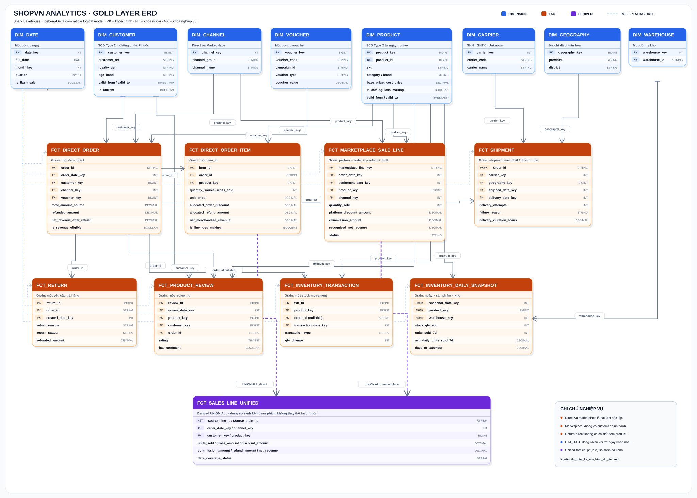
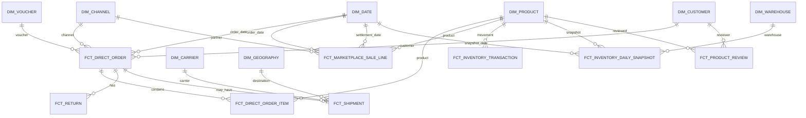

# ShopVN Analytics - Thiết kế mô hình dữ liệu

**Nền tảng đề xuất:** Spark Lakehouse với PySpark + Delta Lake + MinIO  
**Phương pháp mô hình hóa:** Kiến trúc Medallion cho xử lý dữ liệu, mô hình chiều dạng star schema cho phân tích  
**Phạm vi:** Tài chính, Vận hành, Marketing/Khách hàng, Tồn kho/Sản phẩm

---

## 1. Quyết định thiết kế tổng thể

Sử dụng ba lớp dữ liệu logic:

1. **Bronze** lưu dữ liệu bất biến theo đúng cấu trúc nguồn, kèm metadata của lần ingest.
2. **Silver** kiểm tra chất lượng, chuẩn hóa, che PII, loại trùng và giữ nguyên mức chi tiết của từng nguồn.
3. **Gold** cung cấp các dimension dùng chung, fact theo từng quy trình nghiệp vụ và một số data mart tổng hợp.

Đơn hàng trực tiếp và giao dịch marketplace phải nằm trong **hai fact riêng biệt** vì chúng khác nhau về mã định danh, mức chi tiết, dữ liệu khách hàng, phí, quy tắc giảm giá, cách xử lý trả hàng và thời điểm thanh toán. Chỉ hợp nhất hai nguồn qua view `fct_sales_line_unified` sau khi cả hai đã được chuẩn hóa về mức một dòng sản phẩm bán ra.

Chọn Spark Lakehouse vì mục tiêu của dự án không chỉ xử lý bộ dữ liệu mẫu mà còn mô phỏng nguồn phát sinh liên tục và kiểm chứng khả năng mở rộng khi dữ liệu tăng mạnh. PySpark cung cấp xử lý phân tán; Delta Lake bổ sung transaction ACID, schema enforcement/evolution, `MERGE`, time travel và khả năng xử lý cả batch lẫn streaming; MinIO đóng vai trò object storage tương thích S3 trong môi trường local. Chi phí vận hành cao hơn DuckDB là trade-off được chấp nhận để thể hiện kiến trúc gần với production và tránh phải thiết kế lại khi khối lượng dữ liệu phình to.

---

## 2. Nguyên tắc mô hình hóa

- Phải xác định **grain** - một dòng đại diện cho đối tượng gì - trước khi định nghĩa bảng.
- Không join trực tiếp `orders`, `order_items` và `returns` rồi cộng tiền đơn hàng. Phải tổng hợp bảng con về grain của bảng cha trước để tránh nhân bản dữ liệu.
- Lưu các số tiền có tính cộng dồn và cờ chất lượng dữ liệu trong fact gốc. Tỷ lệ và trung bình được tính ở mart hoặc semantic layer.
- Dimension sử dụng surrogate key. Business key từ nguồn chỉ được giữ trong Silver hoặc vùng mapping có kiểm soát truy cập.
- Mỗi dimension có bản ghi `unknown` với khóa `0` để xử lý dữ liệu dimension bị thiếu hoặc đến trễ.
- Phân biệt thời gian phát sinh nghiệp vụ và thời gian xử lý. Fact cần có `event_date_key`, `ingested_at` và `batch_id`.
- Mọi lần load phải có tính xác định và lặp lại an toàn bằng natural key với `MERGE`, hoặc thay thế đúng partition ngày trong một transaction.
- Không tự sửa im lặng các bất thường nghiệp vụ. Giữ giá trị nguồn, thêm cờ cảnh báo và chỉ loại khỏi chỉ số khi yêu cầu nghiệp vụ quy định rõ.

---

## 3. Thiết kế các lớp dữ liệu

### 3.1 Bronze - lưu dữ liệu nguồn bất biến

Lưu vật lý dưới dạng **Delta table trên MinIO**, ví dụ `s3a://shopvn-lakehouse/bronze/...`. Delta vẫn dùng Parquet cho data files nhưng quản lý transaction qua `_delta_log`. Metadata bảng được đăng ký trong catalog/metastore để Spark SQL, job PySpark và công cụ truy vấn dùng chung một định nghĩa schema.

| Dataset Bronze | Grain của nguồn | Phân vùng/định danh | Ghi chú |
|---|---|---|---|
| `brz_pg_customers` | một khách hàng tại nguồn | `extract_date` | Chứa PII, chỉ Data Engineer được truy cập |
| `brz_pg_products` | một sản phẩm tại nguồn | `extract_date` | Có thể full snapshot hằng ngày ở quy mô này |
| `brz_pg_orders` | một đơn hàng trực tiếp | `order_date` | Giữ nguyên tất cả số tiền và trạng thái nguồn |
| `brz_pg_order_items` | một `item_id` | ngày của đơn hàng cha | Vẫn giữ các dòng có số lượng bằng 0 |
| `brz_pg_vouchers` | một voucher | `extract_date` | Snapshot và phát hiện thay đổi bằng hash |
| `brz_pg_inventory` | số dư hiện tại của một sản phẩm | `extract_date` | Là snapshot hiện tại, không phải lịch sử |
| `brz_pg_inventory_transactions` | một giao dịch kho `txn_id` | ngày giao dịch | Nạp tăng dần |
| `brz_pg_returns` | một yêu cầu trả hàng `return_id` | ngày tạo | Upsert vì trạng thái có thể thay đổi |
| `brz_pg_product_reviews` | một đánh giá `review_id` | ngày tạo | Append/upsert |
| `brz_api_shipments` | một phản hồi shipment cho một đơn trực tiếp | ngày trích xuất | Upsert vì trạng thái vận chuyển thay đổi |
| `brz_api_not_found` | một order được yêu cầu nhưng API không tìm thấy | ngày trích xuất | Ghi nhận đầy đủ các trường hợp 404 |
| `brz_sftp_marketplace` | một dòng CSV | partner + ngày nghiệp vụ | Chỉ nạp sau khi MD5 hợp lệ |

Tất cả bản ghi Bronze nên có thêm `_source_system`, `_source_object`, `_ingested_at`, `_batch_id` và `_record_hash`. Dữ liệu SFTP có thêm `_source_file`, `_source_row_number`, `_expected_md5` và `_actual_md5`.

### 3.2 Silver - dữ liệu sạch, chuẩn hóa theo nguồn

Silver giữ nguyên grain của nguồn và là ranh giới dùng để đối soát:

- `slv_customer`: bỏ hoặc token hóa PII; chuẩn hóa địa chỉ và loyalty tier.
- `slv_product`: chuẩn hóa category/SKU; thêm `is_catalog_loss_making = cost_price > base_price`.
- `slv_direct_order`: một đơn hàng; giữ giá trị nguồn và các cờ đủ điều kiện tính doanh thu.
- `slv_direct_order_item`: một `item_id`; giữ dòng quantity bằng 0 nhưng đặt `is_units_eligible = false`.
- `slv_return`: một `return_id`; chỉ `status = 'refunded'` đóng góp vào tiền hoàn.
- `slv_shipment`: trạng thái API mới nhất theo `order_id`, timestamp được chuẩn hóa múi giờ.
- `slv_marketplace_sale`: một dòng marketplace hợp lệ, gồm `net_revenue` nguồn và giá trị tính lại để đối soát.
- `slv_inventory_transaction`, `slv_review`, `slv_voucher`: giữ grain tương ứng của nguồn.

Bản ghi không đạt kiểm tra cấu trúc được đưa vào `ops.rejected_record`. Bất thường nghiệp vụ vẫn hợp lệ phải được giữ trong Silver cùng cờ cảnh báo.

### 3.3 Gold - mô hình chiều

Gold bao gồm các dimension dùng chung, fact nghiệp vụ và mart tổng hợp ở các phần tiếp theo.

---

## 4. Các dimension dùng chung

| Dimension | Grain và khóa | Chiến lược SCD | Thuộc tính quan trọng |
|---|---|---|---|
| `dim_date` | một ngày lịch, `date_key = YYYYMMDD` | tĩnh | ngày/tuần/tháng/quý/năm, thứ, đầu/cuối tháng, cờ flash sale |
| `dim_channel` | một kênh bán | tĩnh | `channel_group` = direct/marketplace; `channel_name` = web/app/lazada/shopee/tiktok |
| `dim_customer` | một phiên bản của khách hàng | **SCD Type 2** | `customer_ref` ẩn danh, địa chỉ, giới tính, nhóm tuổi, loyalty tier, `valid_from`, `valid_to`, `is_current`, `history_reliable` |
| `dim_product` | một phiên bản của sản phẩm ShopVN | SCD Type 2 kể từ ngày pipeline hoạt động | SKU, tên, category, subcategory, brand, giá bán, giá vốn, trọng lượng, active, cờ bán lỗ, thời gian hiệu lực |
| `dim_voucher` | một mã voucher | Type 1; cảnh báo nếu thuộc tính thay đổi bất thường | loại, giá trị, giới hạn, campaign, ngày hiệu lực |
| `dim_carrier` | một đơn vị vận chuyển | tĩnh | ghn, ghtk, unknown |
| `dim_geography` | một cặp tỉnh/quận đã chuẩn hóa | Type 1 | tỉnh, quận/huyện, mã địa lý nếu có |
| `dim_warehouse` | một kho | Type 1 | business key của kho và thuộc tính mô tả nếu có |

### Quy tắc lưu lịch sử loyalty tier

Nguồn chỉ có loyalty tier hiện tại. Trong lần chạy đầu tiên:

- tạo một phiên bản trước thời điểm quan sát với `loyalty_tier = 'unknown'`, có hiệu lực đến thời điểm go-live;
- tạo phiên bản hiện tại bắt đầu từ thời điểm go-live;
- ở các snapshot tiếp theo, chỉ đóng bản ghi hiện tại và thêm phiên bản mới nếu hash của thuộc tính theo dõi thay đổi.

Cách này tránh gán nhầm tier hiện tại cho đơn hàng cũ. Báo cáo nên cung cấp hai góc nhìn:

- **phân khúc theo tier hiện tại**: join vào bản ghi `is_current = true`;
- **phân khúc theo tier tại thời điểm đặt hàng**: join theo timestamp của đơn, với `history_reliable = false` cho lịch sử trước go-live.

Gold không cần họ tên đầy đủ, số điện thoại, email hoặc ngày sinh đầy đủ. Dùng HMAC có khóa làm `customer_ref`, chỉ giữ nhóm tuổi; mapping có khả năng truy ngược phải nằm trong schema hạn chế quyền.

---

## 5. Các bảng fact

### 5.1 `fct_direct_order`

**Grain:** một đơn hàng trực tiếp từ PostgreSQL (`order_id`).  
**Natural key:** `order_id`.  
**Cách load:** `MERGE` theo `order_id`; cập nhật trạng thái, thanh toán và số tiền hoàn có thể thay đổi.

Các cột chính:

- `order_id` là degenerate dimension;
- `order_date_key`, `customer_key`, `channel_key`, `voucher_key` có thể null;
- trạng thái đơn hàng, phương thức và trạng thái thanh toán;
- `subtotal_amount`, `shipping_fee_amount`, `discount_amount`, `total_amount_source`;
- `refunded_amount` tổng hợp từ `fct_return` với trạng thái `refunded`;
- `net_revenue_after_refund`;
- `is_discount_anomaly`, `is_shipping_fee_anomaly`, `is_revenue_eligible`;
- `ingested_at`, `batch_id`.

Quy tắc tài chính đề xuất:

```text
is_revenue_eligible = discount_amount <= subtotal

net_revenue_after_refund =
  CASE
    WHEN NOT is_revenue_eligible THEN NULL
    WHEN order_status = 'cancelled' THEN 0
    ELSE total_amount_source - refunded_amount
  END
```

Với lỗi discount, dùng `NULL` thay vì 0 để Finance phân biệt doanh thu bị loại vì dữ liệu lỗi với đơn hàng thực sự có giá trị 0. Yêu cầu hiện tại chưa quy định rõ đơn chưa thanh toán có được ghi nhận doanh thu hay không; cần giữ `payment_status` và xin xác nhận của Finance trước khi áp dụng bộ lọc chỉ tính đơn đã thanh toán.

### 5.2 `fct_direct_order_item`

**Grain:** một `item_id` tại nguồn.  
**Natural key:** `item_id`.  
**Cách load:** `MERGE` theo `item_id`.

Các cột chính:

- `order_id`, `order_date_key`, `customer_key`, `product_key`, `channel_key`, `voucher_key`;
- `quantity_source`, `units_sold`;
- `unit_price`, `discount_per_item`, `line_amount_source`;
- `allocated_order_discount`, `allocated_shipping_fee`, `allocated_refund_amount`;
- `net_merchandise_revenue`, `reconciled_order_revenue_component`;
- `cost_amount_at_ingestion`, `is_line_loss_making`;
- `is_zero_quantity`, `is_revenue_eligible`, `is_refund_allocation_estimated`.

Quy tắc:

```text
units_sold = CASE WHEN quantity_source > 0 THEN quantity_source ELSE 0 END

effective_unit_sale_price =
  (line_amount_source - allocated_order_discount) / NULLIF(units_sold, 0)

is_line_loss_making = cost_price_at_ingestion > effective_unit_sale_price
```

Chỉ phân bổ discount cấp đơn, phí vận chuyển và tiền hoàn vào các dòng có giá trị dương. Dùng tỷ lệ xác định trước kết hợp điều chỉnh phần dư lớn nhất để tổng số VND sau phân bổ khớp chính xác với số tiền ở order header. Báo cáo Finance chính thức dùng `fct_direct_order`; phân bổ xuống line chỉ phục vụ phân tích sản phẩm vì nguồn return không cho biết sản phẩm được trả.

### 5.3 `fct_marketplace_sale_line`

**Grain:** một dòng đơn hàng marketplace: partner + external order + sản phẩm ShopVN + seller SKU.  
**Natural key:** `(partner, external_order_id, shopvn_product_id, seller_sku)`.  
**Cách load:** chỉ xử lý file có checksum hợp lệ; `MERGE` theo natural key và loại các dòng trùng nhưng có nội dung xung đột.

Các cột chính:

- `external_order_id`, `order_date_key`, `settlement_date_key`, `product_key`, `channel_key`;
- `quantity_sold`, `sale_price`, `gross_sale_amount`;
- `platform_discount_amount`, `commission_rate`, `commission_amount_recomputed`;
- `net_revenue_source`, `net_revenue_recomputed`, `recognized_net_revenue`;
- trạng thái completed/returned/disputed;
- `is_amount_reconciled`, lineage của file nguồn và `batch_id`.

Chỉ sử dụng `net_revenue` từ nguồn sau khi đối soát với công thức tài liệu trong ngưỡng sai số làm tròn VND đã định nghĩa. Quy tắc semantic mặc định an toàn:

```text
recognized_net_revenue =
  CASE WHEN status = 'completed' THEN net_revenue_source ELSE 0 END
```

Tiền của dòng returned và disputed được lưu riêng. `settlement_date` là ngày thanh toán T+15 theo lịch; do không có trường xác nhận thanh toán, không được gọi đây là tiền thực nhận đã kiểm toán.

### 5.4 `fct_return`

**Grain:** một yêu cầu trả hàng (`return_id`).  
**Natural key:** `return_id`.  
**Cách load:** `MERGE` vì trạng thái có thể chuyển từ pending sang refunded.

Cột gồm `order_id`, các khóa customer/order/channel suy ra từ đơn trực tiếp, ngày tạo, lý do, trạng thái, `refund_amount_source` và `refunded_amount`, trong đó `refunded_amount` chỉ có giá trị khi trạng thái là `refunded`.

Nguồn không có `product_id` hoặc bảng return item. Vì vậy không thể tính chính xác tỷ lệ trả hàng ở mức item/category. Chỉ có thể dùng chỉ số thay thế **tỷ lệ đơn trả hàng theo category**:

```text
số đơn refunded khác nhau có chứa category
-------------------------------------------
số đơn hợp lệ khác nhau có chứa category
```

Không được gọi chỉ số này là item return rate. Nếu cần độ chính xác mức sản phẩm, phải bổ sung data contract `return_items(return_id, item_id, quantity, refund_amount)`.

### 5.5 `fct_shipment`

**Grain:** trạng thái shipment mới nhất của một `order_id` trực tiếp.  
**Natural key:** `order_id`.  
**Cách load:** `MERGE`; cập nhật trạng thái hiện tại, còn Bronze giữ lịch sử phản hồi.

Cột gồm carrier, trạng thái shipment, tracking code, khóa ngày gửi/giao/ước tính, địa chỉ người nhận, phí giao thực tế, số lần giao, lý do thất bại và thời gian giao tính theo giờ.

Đơn không có phản hồi API không được tạo shipment giả. Delivery mart phải bắt đầu từ `fct_direct_order`, left join vào fact này rồi suy ra `has_shipment = false`, carrier và geography bằng unknown cho nhóm 404 hoặc hủy trước khi lấy hàng.

### 5.6 `fct_inventory_transaction`

**Grain:** một biến động kho (`txn_id`).  
**Natural key:** `txn_id`.  
**Cách load:** append hoặc `MERGE` theo transaction ID.

Cột gồm sản phẩm, đơn hàng có thể null, timestamp/ngày giao dịch, loại giao dịch và `qty_change` có dấu. Đây là fact kiểm toán hỗ trợ dựng lại tồn kho.

### 5.7 `fct_inventory_daily_snapshot`

**Grain:** một ngày snapshot x sản phẩm x kho.  
**Natural key:** `(snapshot_date_key, product_key, warehouse_key)`.  
**Cách load:** tính lại rồi thay thế/merge atomically đúng partition ngày được yêu cầu.

Cột gồm `stock_qty_eod`, `units_sold_7d`, `avg_daily_units_sold_7d` và `days_to_stockout`. Nên giữ cả tốc độ bán bảy ngày gốc và tốc độ tùy chọn đã điều chỉnh flash sale; giá trị điều chỉnh phải được ghi rõ là giả định dự báo.

Công thức dựng lại:

```text
stock_qty_eod(D) = current_stock_qty
                   - sum(qty_change với transaction_time > cuối ngày D)
```

Nếu số dư hiện tại không đối soát được với toàn bộ lịch sử transaction, phải chặn quality gate thay vì xuất bản tồn kho âm hoặc không giải thích được.

### 5.8 `fct_product_review`

**Grain:** một đánh giá (`review_id`).  
**Natural key:** `review_id`.  
**Cách load:** `MERGE` theo review ID.

Cột gồm ngày đánh giá, sản phẩm, khách hàng, đơn trực tiếp, kênh direct suy ra, rating, `has_comment` và tham chiếu comment đã xử lý nếu cần. Không sao chép comment tự do vào Gold không hạn chế quyền nếu chưa quét PII.

Nguồn review hiện tại chỉ bao phủ đơn trực tiếp trong PostgreSQL. Không thể so sánh rating marketplace nếu chưa bổ sung nguồn đánh giá từ marketplace.

---

## 6. View bán hàng hợp nhất

Tạo `gold.fct_sales_line_unified` dưới dạng **view hoặc bảng incremental**, không dùng nó làm fact bán hàng duy nhất.

**Grain:** một dòng đơn hàng trực tiếp hoặc marketplace đã chuẩn hóa.

| Cột | Mapping direct | Mapping marketplace |
|---|---|---|
| `source_order_id` | `order_id` | `external_order_id` |
| `source_line_id` | `item_id` | natural key tổng hợp của marketplace |
| `order_date_key` | ngày đặt đơn trực tiếp | ngày đặt đơn marketplace |
| `settlement_date_key` | null | ngày T+15 dự kiến |
| `channel_key` | web/app | lazada/shopee/tiktok |
| `customer_key` | khách hàng đã biết | unknown key `0` |
| `product_key` | sản phẩm ShopVN | join bằng `shopvn_product_id` |
| `units_sold` | chỉ quantity dương | `quantity_sold` |
| `gross_amount` | tiền line trước discount được phân bổ | sale price x quantity |
| `discount_amount` | item discount + order discount phân bổ | platform discount |
| `commission_amount` | 0 | phí hoa hồng nền tảng |
| `refund_amount` | tiền hoàn ước tính được phân bổ | giá trị dòng trả hàng theo quy tắc đã phê duyệt |
| `net_revenue` | doanh thu line sau phân bổ | doanh thu marketplace được ghi nhận |
| `data_coverage_status` | complete/invalid | complete/missing/corrupt/late |

Dùng view này để so sánh kênh và sản phẩm. Đối soát Finance chi tiết phải sử dụng các fact riêng theo nguồn.

Không được join `external_order_id` với `order_id` trực tiếp. Quan hệ xuyên nguồn duy nhất của marketplace là ShopVN product ID và các dimension dùng chung như ngày/kênh.

---

## 7. Các mart tổng hợp

Đây là các bảng materialized tùy chọn. SQL tạo mart phải tái tạo được từ Gold facts.

| Mart | Grain | Use case chính |
|---|---|---|
| `mart_daily_revenue` | ngày x kênh | doanh thu gộp, discount, commission, refund, net revenue, số dòng hợp lệ/bị loại, trạng thái bao phủ dữ liệu |
| `mart_customer_spend_daily` | ngày x khách hàng direct | chi tiêu và số đơn mỗi ngày |
| `mart_customer_spend_monthly` | tháng x khách hàng direct | chi tiêu tháng, xếp hạng, chỉ báo first/repeat |
| `mart_campaign_daily` | ngày x voucher/campaign | lượt dùng, doanh thu quy gán, chi phí discount, giá trị đơn trung bình |
| `mart_delivery_daily_carrier` | ngày giao/đặt x carrier | tỷ lệ thành công/thất bại, thời gian giao trung bình, tỷ lệ giao lại |
| `mart_delivery_failure_reason` | ngày x carrier x geography x reason | phân bố lý do giao thất bại |
| `mart_product_channel_daily` | ngày x sản phẩm x kênh | số lượng, gross/net revenue, chỉ số trả hàng, cờ bán lỗ |
| `mart_inventory_health_daily` | ngày snapshot x sản phẩm | tồn kho, tốc độ 7 ngày, số ngày đến hết hàng, cờ hết hàng trong 7 ngày |
| `mart_customer_lifecycle` | khách hàng direct | đơn đầu, đơn gần nhất, số đơn, số ngày inactive, cờ mua lại trong 30 ngày |

Không tính top customer trên toàn bộ các kênh vì SFTP không có customer identifier. Các chỉ số mức khách hàng là chỉ số của direct channel và phải được ghi nhãn rõ.

---

## 8. ERD lớp Gold



> Bản PNG: [`images/shopvn_gold_erd.png`](images/shopvn_gold_erd.png). Bản SVG nên được dùng trong tài liệu và slide vì có thể phóng to mà không vỡ nét.



`fct_sales_line_unified` và các mart không xuất hiện trong ERD vì chúng được dẫn xuất từ các base fact.

---

## 9. Mapping từ nguồn đến đích

| Nguồn | Silver chính | Gold chính |
|---|---|---|
| PostgreSQL `customers` | `slv_customer` | `dim_customer` |
| PostgreSQL `products` | `slv_product` | `dim_product` |
| PostgreSQL `orders` | `slv_direct_order` | `fct_direct_order` |
| PostgreSQL `order_items` | `slv_direct_order_item` | `fct_direct_order_item` |
| PostgreSQL `vouchers` | `slv_voucher` | `dim_voucher` |
| PostgreSQL `inventory` | staging số dư hiện tại | `fct_inventory_daily_snapshot` |
| PostgreSQL `inventory_transactions` | `slv_inventory_transaction` | `fct_inventory_transaction`, dựng snapshot |
| PostgreSQL `returns` | `slv_return` | `fct_return`, tổng tiền hoàn theo order |
| PostgreSQL `product_reviews` | `slv_review` | `fct_product_review` |
| Logistics API | `slv_shipment` | `fct_shipment` |
| Marketplace SFTP | `slv_marketplace_sale` | `fct_marketplace_sale_line` |

---

## 10. Idempotency và chiến lược load vật lý

| Loại bảng | Chiến lược | Khóa idempotency |
|---|---|---|
| Fact sự kiện bất biến | `MERGE ... WHEN NOT MATCHED INSERT`; đối chiếu hash khi đã tồn tại | ID sự kiện nguồn |
| Fact có thể thay đổi | `MERGE`, chỉ update khi source hash thay đổi | business key nguồn |
| Dimension Type 1 | `MERGE` | natural key |
| Dimension Type 2 | đóng bản ghi hiện tại và thêm phiên bản mới trong cùng transaction | natural key + `valid_from` |
| Snapshot hằng ngày | thay thế hoặc merge đúng một ngày trong transaction | ngày + các dimensional key |
| Mart tổng hợp | dựng lại các ngày bị ảnh hưởng sau khi base fact commit | grain của mart |
| File SFTP | không xử lý lại cùng partner/ngày/checksum | partner + ngày nghiệp vụ + checksum |

Airflow điều phối các job bằng `SparkSubmitOperator` hoặc API của Spark cluster. Các task extract có thể chạy song song và ghi vào đường dẫn Bronze độc lập theo nguồn/ngày/batch. Job Silver và Gold chỉ chạy sau khi quality gate của lớp trước thành công.

Delta Lake dùng optimistic concurrency control và transaction log để đảm bảo ACID. Tuy vậy, không nên để nhiều job đồng thời sửa cùng bảng hoặc cùng partition. Airflow pool và dependency phải ngăn hai lần backfill/rerun cùng xử lý một `logical_date`. Với các bảng cần `MERGE`, job phải deduplicate source theo natural key trước khi ghi; nếu source có hai bản ghi khác nhau cho cùng khóa, quality gate phải chặn load.

### 10.1 Bố trí lưu trữ Lakehouse

```text
s3a://shopvn-lakehouse/
├── bronze/<source>/<table>/ingestion_date=YYYY-MM-DD/
├── silver/<domain>/<table>/event_date=YYYY-MM-DD/
├── gold/dimensions/<table>/
├── gold/facts/<table>/order_month=YYYY-MM/
├── gold/marts/<table>/report_date=YYYY-MM-DD/
├── checkpoints/<stream_name>/
└── quarantine/<source>/<table>/ingestion_date=YYYY-MM-DD/
```

- Bronze phân vùng theo `ingestion_date`; SFTP thêm `partner` khi số file và dữ liệu đủ lớn.
- Fact lớn ở Silver/Gold phân vùng theo ngày hoặc tháng nghiệp vụ tùy volume thực tế. Bắt đầu bằng tháng để tránh quá nhiều partition nhỏ, chuyển sang ngày khi một tháng đã đủ lớn.
- Dimension nhỏ không partition.
- Không partition theo `customer_id`, `product_id` hoặc `order_id` vì cardinality quá cao.
- Chạy compaction định kỳ để gộp small files; chỉ chạy `VACUUM` sau thời gian lưu giữ đủ dài để không phá backfill/time travel đang cần.
- Dùng data skipping hoặc clustering/Z-order theo `order_date`, `product_id`, `customer_id` nếu phiên bản Delta và query engine được chọn hỗ trợ.

### 10.2 Batch và nguồn dữ liệu mô phỏng

Batch hằng ngày vẫn là luồng chính để đáp ứng SLA 08:00. Nguồn giả lập có thể ghi thêm file hoặc event liên tục vào landing zone và được ingest bằng Spark Structured Streaming:

- mỗi stream có checkpoint riêng trên MinIO;
- dùng event-time watermark để quản lý dữ liệu đến trễ;
- `foreachBatch` thực hiện deduplicate và `MERGE` vào Delta bằng cùng natural key với batch;
- `batch_id`, `event_time` và `ingested_at` cho phép đối soát, replay và xác định dữ liệu đến trễ;
- streaming không ghi trực tiếp mart Finance; mart chỉ được publish sau quality gate và reconciliation của micro-batch hoặc kỳ batch tương ứng.

Các bảng vận hành đề xuất:

- `ops.pipeline_run(batch_id, logical_date, started_at, finished_at, status, code_version)`;
- `ops.source_file_manifest(partner, business_date, file_name, expected_md5, actual_md5, status, row_count, amount_sum, batch_id)`;
- `ops.source_extract_audit(source, object, watermark_start, watermark_end, row_count, amount_sum, batch_id)`;
- `ops.dq_result(batch_id, dataset, check_name, severity, passed, actual_value, expected_value, details)`;
- `ops.rejected_record(batch_id, source, object, business_key, reason_code, payload_ref)`;
- `ops.data_coverage(date, source, partner, status, reason, batch_id)`.

`mart_daily_revenue` bắt buộc có `data_coverage_status`. Pipeline có thể tiếp tục khi thiếu file của một partner, nhưng tổng doanh thu ngày đó phải được đánh dấu partial; nếu không, DAG thành công về kỹ thuật vẫn có thể công bố số liệu Finance sai lệch.

---

## 11. Các quality gate bắt buộc

Chạy trước khi công bố Gold và mart:

1. Kiểm tra duy nhất của primary/natural key tại mọi grain đã khai báo.
2. Không null ở business identifier, ngày, kênh hoặc product mapping bắt buộc.
3. Đối soát số dòng PostgreSQL theo bảng và ngày.
4. Đối soát đơn trực tiếp: subtotal, order total và tổng tiền đã refund.
5. Đối soát phân bổ item: tổng các thành phần được phân bổ phải khớp chính xác order header với các đơn hợp lệ.
6. Kiểm tra MD5 SFTP trước khi parse.
7. Đối soát số dòng và tổng `net_revenue` nguồn theo partner/ngày/file marketplace.
8. Đối soát công thức marketplace với quy tắc floor/làm tròn và tolerance rõ ràng.
9. Kiểm tra coverage API: found + not-found + terminally-skipped phải bằng tổng số order đã yêu cầu.
10. Kiểm tra cân bằng tồn kho và không có tồn cuối ngày âm không giải thích được.
11. Khoảng thời gian hiệu lực của cùng một natural key trong dimension không được chồng lấn.
12. Đối soát Gold với mart về số dòng và tổng tiền.

Chặn việc công bố khi có lỗi cấu trúc, checksum sai, trùng khóa, đối soát tiền sai hoặc API chưa được hạch toán đầy đủ. Các bất thường nghiệp vụ được yêu cầu cho phép phải tiếp tục truy vấn được bằng cờ cảnh báo.

---

## 12. Các giới hạn nghiệp vụ phải trình bày

1. **Không có customer analytics cho marketplace.** SFTP không cung cấp customer key; top customer và loyalty analysis chỉ áp dụng cho direct channel.
2. **Không có return chính xác ở mức sản phẩm cho direct channel.** `returns` chỉ liên kết `order_id`; tỷ lệ trả theo category chỉ là chỉ số thay thế ở mức đơn hàng nếu chưa bổ sung `return_items`.
3. **Không có rating marketplace.** `product_reviews` chỉ liên kết với đơn hàng PostgreSQL trực tiếp.
4. **Không thể biết loyalty tier trước ngày pipeline go-live.** Phần lịch sử này phải được đánh dấu unknown/unreliable, không được backfill bằng tier hiện tại.
5. **Không có lịch sử giá vốn sản phẩm.** Phân tích lãi/lỗ cho đơn cũ sử dụng giá vốn quan sát tại thời điểm ingest và phải được ghi nhãn rõ.
6. **Settlement date chỉ là ngày dự kiến.** Nó phục vụ báo cáo khoản dự kiến nhận, không phải bằng chứng tiền đã thực nhận.
7. **Order ID marketplace và direct không liên quan.** Việc hợp nhất là `UNION ALL` ở grain đã chuẩn hóa, tuyệt đối không join ở mức order.

Đây là các khoảng trống của data contract, không phải lỗi transformation. Trình bày rõ giới hạn sẽ an toàn hơn việc tạo ra độ chính xác giả mà nguồn dữ liệu không hỗ trợ.
