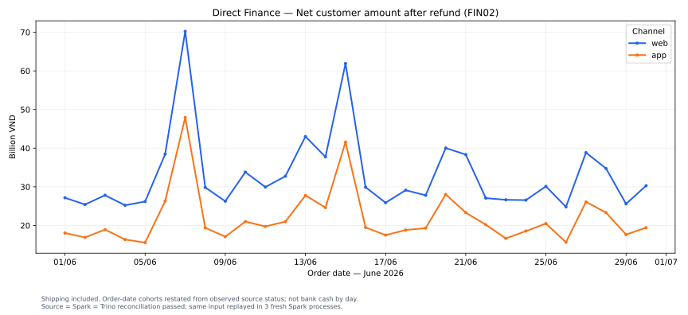

# Kết quả kiểm chứng core lakehouse và direct Finance

Ngày thực hiện: 2026-11-11. Core storage spike và direct Finance slice đều đã chạy thực tế, không chỉ validate Compose. [Storage evidence](storage-spike.json), [direct evidence](direct-finance.json), [image/JAR lock](../../infra/platform/spike/verified-lock.json).

## Storage spike — PASS

- Spark 3.5.9 / Scala 2.12.18 / Python 3.11.15 / Java 17.0.21.
- Iceberg 1.12.0 format v2, S3FileIO, MinIO build từ commit upstream, PostgreSQL JDBC Catalog.
- MERGE update/insert và thêm schema column hoạt động.
- Ba Spark process mới: mỗi lần 2 keys, tổng 325.00.
- Trino 484 đọc cùng count/sum trước và sau restart catalog + MinIO + Trino.
- Image/JAR identities đã được ghi ở verified-lock.json; scope chỉ core đã test. Airflow provider, Kafka và Superset chưa được chứng nhận runtime.

## Direct Finance — PASS

Nguồn được đọc trong **một transaction PostgreSQL REPEATABLE READ, READ ONLY** bằng shopvn_reader. CSV streaming nằm trong runtime/ bị Git ignore. Không export full_name/phone/email/DOB. Customer IDs trong raw/silver là dữ liệu hạn chế quyền truy cập; Gold dùng customer_ref HMAC với key cục bộ không commit.

Giữ và backup runtime/direct/hmac.key cùng dữ liệu/catalog của môi trường. Không xóa runtime rồi tạo key mới khi vẫn muốn giữ customer identity đã nạp; key rotation cần quy trình riêng. Không đưa key hoặc raw CSV vào Git.

| Nội dung | Kết quả |
|---|---:|
| orders / fact_order | 211806 |
| order_items / fact_sales_line | 444142 |
| returns / fact_return | 4215 |
| customers / products / vouchers nguồn | 50000 / 2000 / 200 |
| Eligible orders theo BR02/BR27 | 110911 |
| FIN02 PostgreSQL = Spark = Trino | 1648602104364.00 VND |
| Mart ngày × kênh | 60 dòng |
| Discount > subtotal bị loại revenue | 622 orders |
| Quantity 0 không tính units hợp lệ | 4420 lines |

Ba process Spark độc lập chạy lại cùng snapshot: fact counts và FIN02 không đổi. Bronze cùng snapshot không append lại; facts MERGE theo key/hash. Mart chỉ thay thế sau khi count, identity, line/header allocation và daily FIN02 khớp nguồn. Advisory lock trên catalog database ngăn hai writer đồng thời cấp surrogate keys.



Biểu đồ được render từ kết quả query Trino đã đối soát, không dùng số nhập tay. FIN02 bao gồm shipping khách trả, chỉ trừ return refunded, gán về order_date và restate theo trạng thái nguồn hiện quan sát. Không phải cash nhận vào từng ngày hoặc net merchandise chính xác.

## Phạm vi implementation hiện tại

- Bronze/Silver cho 6 nguồn direct: orders, order_items, returns, customers (chỉ thuộc tính cho phép), products, vouchers.
- Gold: dim_date, dim_channel direct, dim_customer/dim_product observed versions; fact_order, fact_sales_line, fact_return.
- Initial customer/product versions và stable SK map đã được nạp; June facts gắn initial_snapshot_fallback. Không chứng minh tier/cost lịch sử tại lúc mua. Complete SCD2/as-of behavior cho các kỳ sau go-live cần kiểm thử riêng.
- dim_date hiện là date spine của kỳ direct đã nạp, chưa phải calendar hoàn chỉnh. Voucher source có ở Bronze/Silver; dim_voucher/campaign analytics chưa thuộc slice này. Một số field mục tiêu trong data dictionary chưa triển khai ở slice Finance; không coi toàn bộ ERD đích là đã deploy.
- Certified output là bảng vật lý lakehouse.analytics.mart_fin02_daily. Atomic replace của mart không phải multi-table transaction toàn bộ Gold. Analytics consumer chỉ dùng mart đã phê chuẩn.
- Đây là triển khai local đơn node, entry point chạy CLI. Chưa có DAG Airflow, Kafka ingestion, Superset dashboard, RBAC production, monitoring/alerting hoặc toàn bộ ops audit tables. Trino/MinIO host ports chỉ bind loopback.

## Các lỗi thật đã xử lý

1. COMPOSE_PROJECT_NAME trong .env lấn át name trong YAML: runner dùng --project-name shopvn-readiness rõ ràng. Các container thử ban đầu có prefix shopvn-sources được xác minh thuộc spike rồi stop; dữ liệu/containers nguồn của người dùng không bị xóa.
2. Seed MERGE INSERT * không tương thích khi bảng đã thêm cột: đổi thành explicit insert column list; rerun sau schema evolution thành công.
3. PostgreSQL COPY boolean là t/f: Bronze giữ wire value, Silver chuyển sang boolean có kiểm tra accepted encodings; không dùng permissive parser để nuốt lỗi.
4. Có 403 order source discount lẻ phần VND. Vẫn phân bổ integer VND theo rank ổn định, phần dư dưới 1 VND được cộng vào rank 1 để giữ đúng precision nguồn DECIMAL(20,2). Không truncate source amount hoặc thay FIN02. Có thêm 3 regression cases; tổng hiện 23 unit/reference tests pass.

## Chạy lại trên máy hiện tại

```powershell
.venv/Scripts/python.exe scripts/run_lakehouse_spike.py --keep-running
.venv/Scripts/python.exe scripts/run_direct_slice.py --keep-running
.venv/Scripts/python.exe scripts/render_finance_chart.py
.venv/Scripts/python.exe scripts/export_verification.py
```

Direct runner mặc định extract snapshot mới. Muốn replay snapshot cũ, thêm --snapshot-id với ID trong runtime/direct/latest-snapshot.json; không sửa CSV/manifest để tạo số khớp. Nếu gặp mismatch, mart không được publish, xem runtime/direct/direct-result.json và direct-slice-report.json.

Hướng dẫn dựng từ đầu: [spike runbook](../../infra/platform/spike/README.md). Source containers phải đang sẵn sàng theo [README gốc](../../README.md); không dựng thêm bộ nguồn trùng port nếu đã có container được cung cấp đang chạy.

## Truy vấn và dừng

Trino UI: http://localhost:18080 (monitoring query, không phải dashboard Finance). Kết nối SQL client: jdbc:trino://localhost:18080/lakehouse/analytics, user readiness cho demo cục bộ. Query [direct Finance mart](../../sql/views/direct_finance.sql).

```powershell
docker compose --project-name shopvn-readiness --env-file .env -f infra/platform/spike/compose.yml stop
```

Lệnh stop giữ data/catalog volumes. Không dùng down -v hoặc xóa object files. Các service nguồn có project/network riêng không nằm trong lệnh dừng này.
